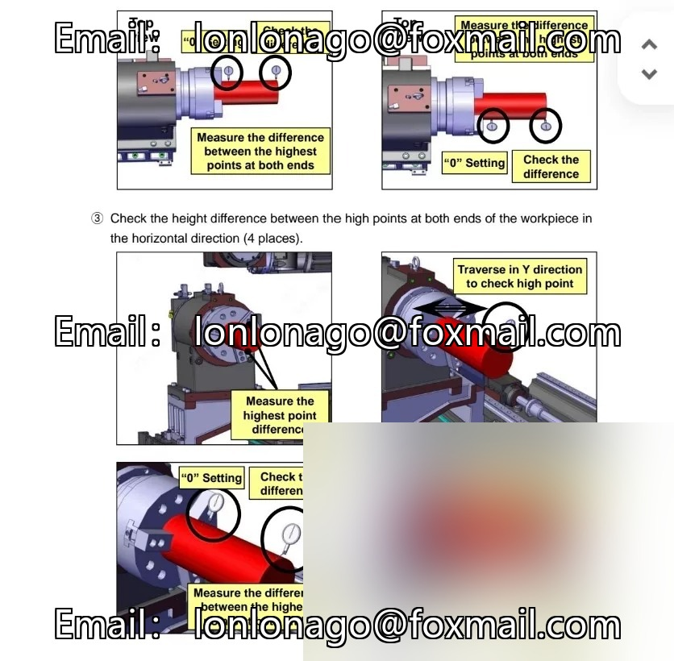
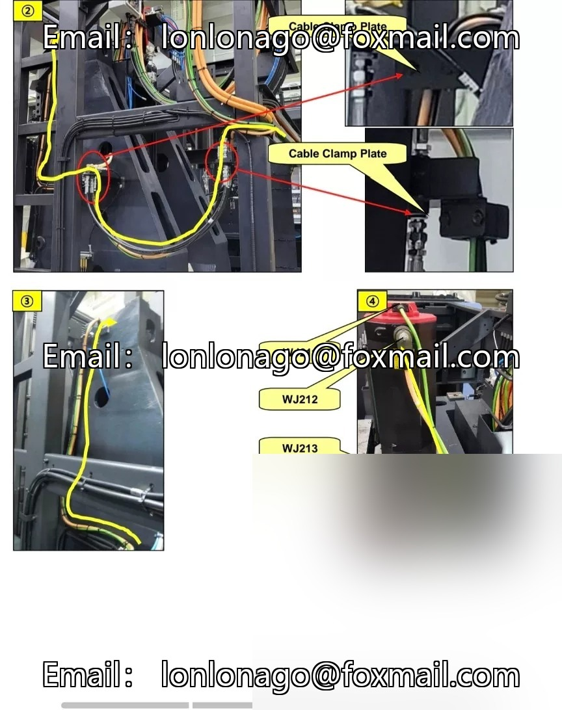
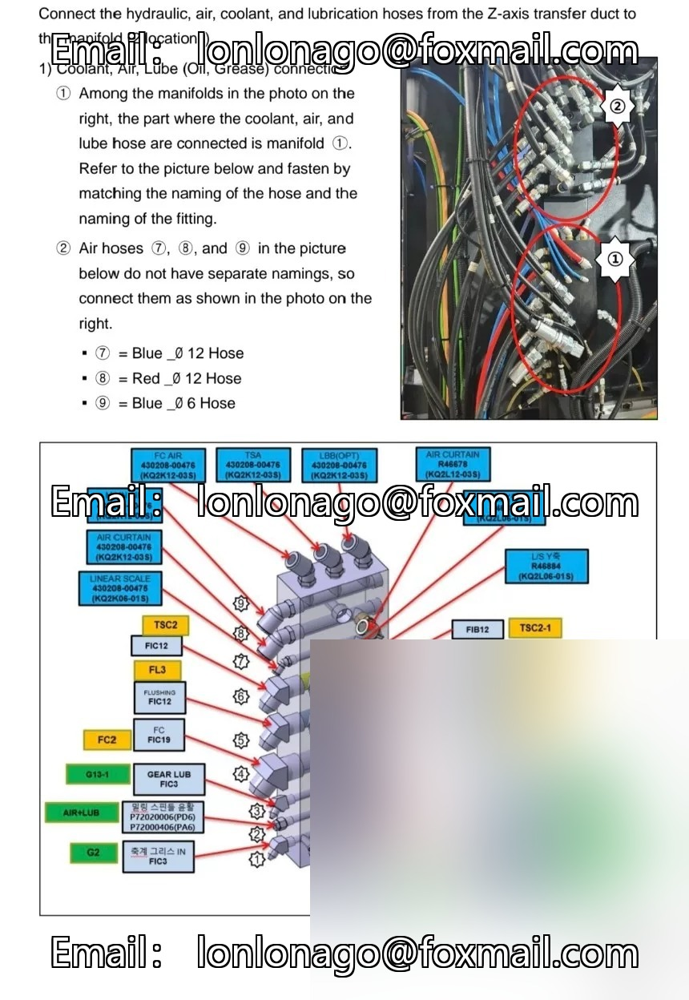
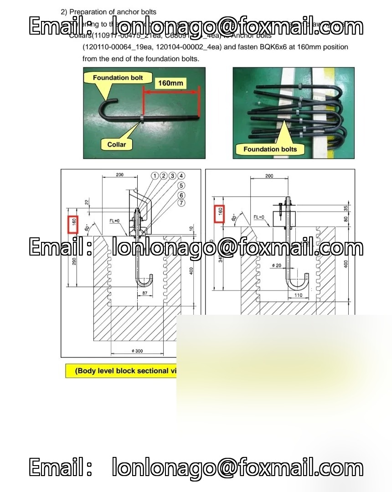
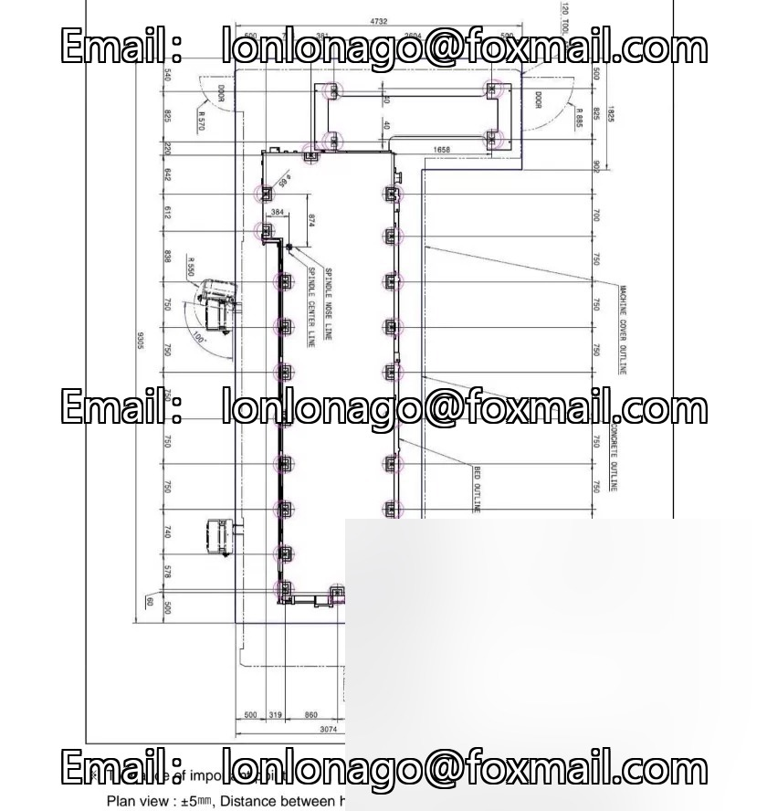

# SMX 510 technical data design material

## Body

SMX 510 Technical Materials Design Materials DN SOLUTIONS (formerly Doosan Machine Tools, Doosan Machine Tools) SMX 5100XL multi-task composite machining machine installation manual, PDF , 150 pages.
69142
1. Core content analysis
1. Installation manual (Installation Manual): suitable for SMX series flagship level road milling machine with milling, machining, drilling, threading, etc., SMX 5100XL is the large-specification model, technical highlights are as follows:
   - Multi-task integration: integrates milling, cutting, drilling, threading into one, supports the processing of complex parts in a single clamp.

- Axial milling spindle: equipped with axial motion function (-30°~+120°), supports five-axis drive, and can process complex surfaces.
- Dual spindle/dual blade tower: The XL model standardly includes a second spindle, achieving automatic handover and two-sided machining, improving efficiency.
- Large specifications processing: The 5100 level is suitable for medium and large-scale axis-type and disc-type parts.
- Y-axis function: The blade tower has an Y-axis, extending milling capabilities.

2. PDF , 150 pages, covering installation, debugging, precautions, etc., suitable for equipment maintenance and technical personnel reference.

2. Applicable scenarios
Suitable for the installation, debugging, maintenance, and technological upgrade of SMX 5100XL machine tools, which is an important technical support for the efficient operation of equipment.

3. Delivery method
PDF , cannot be refunded upon sale.

The material covers SMX 510 technical design assets, including the SMX 5100XL multi-module machining machine installation manual, PDF content and applicable scenarios, along with graphical design guidance.

<!-- AI_ENRICHED -->

## Images

## Payment

Here is a pay link on Stripe ( https://buy.stripe.com/3cs8yP7sY87d0vu9AB ). Please contact me lonlonago@foxmail.com after funding $89, and I will send you a complete data files , thank you!

